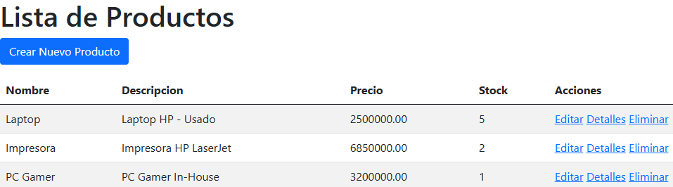
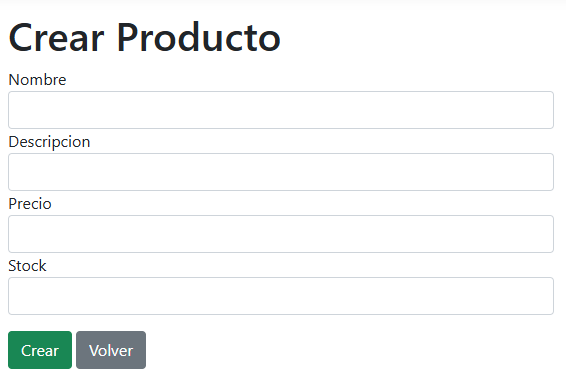
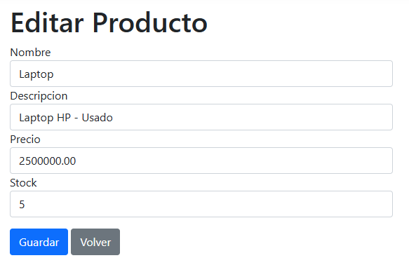

# ProductoMVC

Aplicación web desarrollada en **.NET 8 MVC** con **Entity Framework Core** y **SQL Server**, containerizada con **Docker**. Permite la gestión completa de productos mediante operaciones CRUD.

## 🛠️ Tecnologías

- .NET 8 MVC
- C#
- Entity Framework Core 8
- SQL Server 2022
- Docker + Docker Compose
- Razor Views
- Bootstrap 5

## 🚀 Funcionalidades

- ✅ Listado de productos
- ✅ Crear nuevo producto
- ✅ Ver detalles
- ✅ Editar producto
- ✅ Eliminar producto
- ✅ Validaciones de datos (precio > 0, stock >= 0)
- ✅ Conexión a SQL Server mediante EF Core
- ✅ Despliegue completo con Docker Compose

## 📸 Capturas

### Lista de productos


### Crear producto


### Editar producto


## ⚙️ Cómo ejecutar

### Requisitos
- Docker Desktop instalado
- WSL 2 (si estás en Windows)

### Pasos

1. Clonar el repositorio:
   ```bash
   git clone https://github.com/jesidcampos/ProductoMVC.git
   cd ProductoMVC

2. Levantar los contenedores:

   docker compose up --build

3. Aplicar las migraciones (en otra terminal):

   dotnet ef database update

4. Abrir en el navegador:

   http://localhost:8080

Detener la aplicación

docker compose down

📂 Estructura del proyecto

ProductoMVC/
├── Controllers/
│   └── ProductosController.cs
├── Data/
│   └── ApplicationDbContext.cs
├── Models/
│   └── Producto.cs
├── Views/
│   └── Productos/
│       ├── Index.cshtml
│       ├── Create.cshtml
│       ├── Edit.cshtml
│       ├── Details.cshtml
│       └── Delete.cshtml
├── Dockerfile
├── docker-compose.yml
└── README.md

👤 Autor

José Yesid Campos Barbosa

Ingeniero de Sistemas | Desarrollador .NET | Soporte Técnico Remoto

LinkedIn: yesid-campos-barbosa

GitHub: @jesidcampos